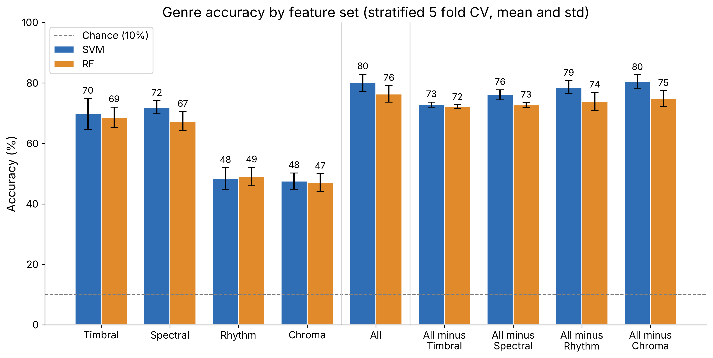
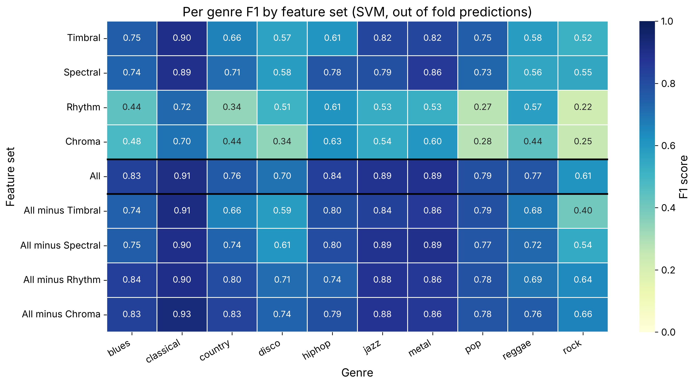
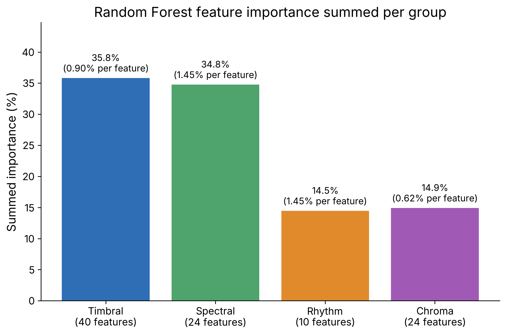
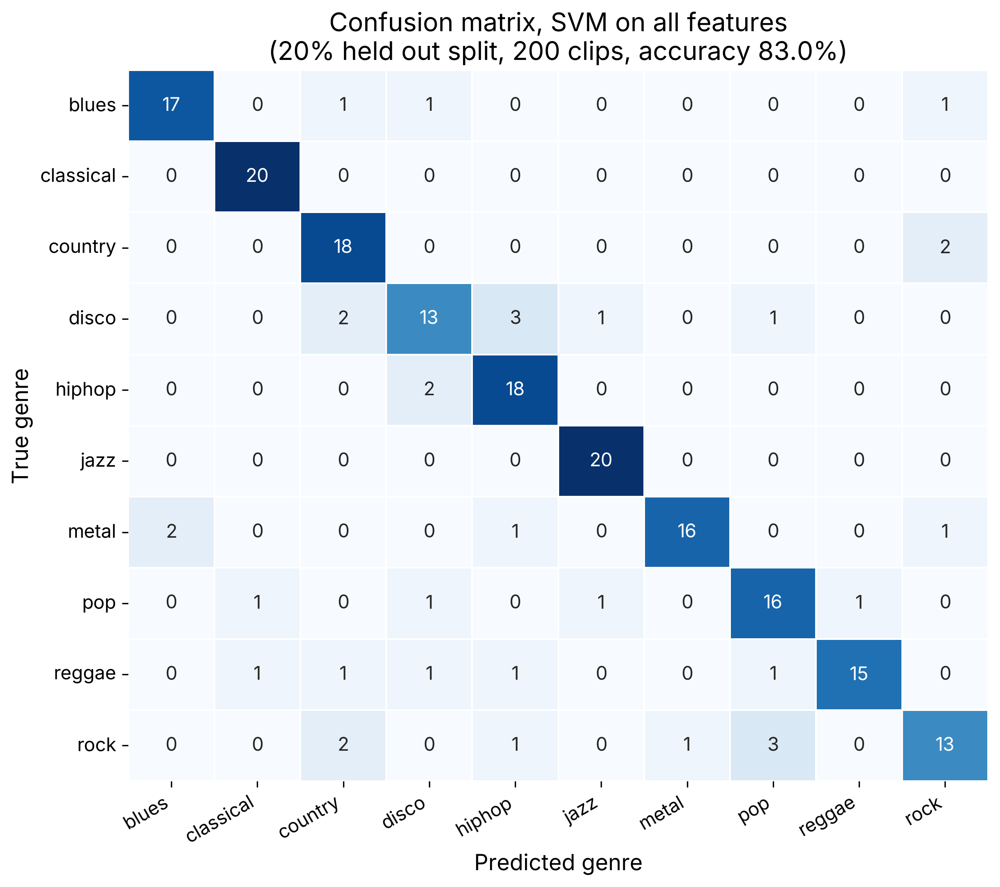

# music-genre-pr

A Pattern Recognition study on the GTZAN music genre dataset. Instead of chasing one accuracy number, the project asks:

> Which categories of audio features actually carry the information that separates music genres, and why does that match musical intuition?

To answer it, I extract four separate groups of hand crafted features from the raw audio. I train two classic classifiers on each group alone, on all groups together, and on all groups minus one (a feature group ablation). Then I compare what each group adds, overall and genre by genre.

## Dataset

GTZAN has 1000 clips of 30 s each, 100 per genre across 10 genres (blues, classical, country, disco, hiphop, jazz, metal, pop, reggae, rock). The audio comes from the `sanchit-gandhi/gtzan` parquet mirror on Hugging Face. It is decoded and resampled to 22050 Hz mono wav. The mirror does not include `jazz.00054` (the clip that is corrupted in most copies), so **999 clips** are used. Skipped clips are logged in `data/features/features_meta.json`.

## Feature groups

Frame level features (n_fft 2048, hop 512) summarised per clip by mean and std. 98 features in total:

| Group | Prefix | Features | Count | What it captures |
|---|---|---|---|---|
| Timbral | `mfcc_` | MFCC 1 to 20 | 40 | Tone colour, texture of the sound |
| Spectral | `spec_` | centroid, rolloff, bandwidth, zero crossing rate, RMS, spectral contrast (7 bands) | 24 | Brightness, sharpness, noisiness, loudness |
| Rhythm | `rhy_` | tempo, onset strength stats, beat interval stats, beats per second, tempogram mean / std / peak | 10 | Groove and pacing |
| Chroma | `chroma_` | 12 pitch class chroma (STFT) | 24 | Harmony, which notes are played |

## Method

- Classifiers: SVM with RBF kernel, and Random Forest. Scaling sits inside an sklearn `Pipeline` so nothing leaks across folds.
- Reported numbers come from stratified 5 fold CV (mean and std). Tuning is nested inside each training fold with a small grid (SVM: C and gamma; RF: n_estimators and max_depth) and an inner 3 fold CV. Seed 42 everywhere.
- 9 feature sets x 2 classifiers = 18 runs.
- The confusion matrix uses one extra stratified 80/20 held out split.
- The demo model is the best combined model (SVM, C=10, gamma=0.01), refit on all 999 clips.

## Results

CV accuracy (%), mean ± std over 5 folds:

| Feature set | Features | SVM | Random Forest |
|---|---|---|---|
| Timbral only | 40 | 69.8 ± 5.1 | 68.7 ± 3.4 |
| Spectral only | 24 | 72.0 ± 2.2 | 67.4 ± 3.1 |
| Rhythm only | 10 | 48.4 ± 3.5 | 49.0 ± 3.0 |
| Chroma only | 24 | 47.6 ± 2.7 | 47.0 ± 3.0 |
| **All combined** | 98 | **80.1 ± 2.8** | **76.4 ± 2.7** |
| All minus Timbral | 58 | 72.9 ± 0.8 | 72.2 ± 0.6 |
| All minus Spectral | 74 | 76.1 ± 1.7 | 72.8 ± 0.8 |
| All minus Rhythm | 88 | 78.6 ± 2.1 | 73.9 ± 3.0 |
| All minus Chroma | 74 | 80.5 ± 2.2 | 74.8 ± 2.6 |

Chance is 10%. Full numbers, including macro F1 and the chosen parameters per fold, are in `results/ablation_results.csv`.









## What the ablation shows

**Timbre and spectral shape do most of the work.** On their own, timbral and spectral features each reach about 70%. Rhythm and chroma reach about 48%, still almost five times chance. Removing timbral features costs the most (80.1 to 72.9% for SVM), then spectral (to 76.1%). This matches intuition: what a genre "sounds like" is mostly its instruments and production. Distorted guitars, a solo piano, a drum machine and a brass section all leave a distinct mark on the spectral envelope, and that envelope is exactly what MFCCs and spectral descriptors measure.

**The groups overlap but are not redundant.** Combining all four beats the best single group by about 8 points for both classifiers. Timbral and spectral features both describe the spectrum, yet dropping either one still hurts, so they capture different parts of it.

**Rhythm matters for the genres defined by their beat.** Dropping rhythm only costs about 1.5 points overall. But per genre, the drop is concentrated where you would expect: hiphop F1 falls from 0.84 to 0.74 and reggae from 0.77 to 0.69. With rhythm alone, hiphop (0.61), reggae (0.57) and disco (0.51) do far better than rock (0.22) or pop (0.27). Those three genres have steady, characteristic grooves (the hiphop beat, the reggae off beat, four on the floor disco). Rock and pop share common tempos and straight beats, so the beat alone says little about them. In the Random Forest, the single most important feature is the mean onset strength, a rhythm feature.

**Chroma adds almost nothing.** Removing it leaves accuracy unchanged (80.5% vs 80.1% for SVM, within one std). Averaged over 30 s, chroma mostly encodes the key and the common chords. Any genre can be played in any key, so this information is not genre specific. Classical is the exception (chroma alone gives F1 0.70), likely because its harmony and sustained tones differ from beat driven popular music.

**Easy and hard genres.** Classical, jazz and metal are the easiest genres with timbral or spectral features (F1 0.79 to 0.90), because they sit at the extremes of the timbre space (acoustic and soft vs very dense and bright). Classical is even the best genre with rhythm alone (0.72), since its lack of a steady drum beat is itself a strong cue. Rock is the hardest genre (F1 0.61 with all features). It borrows its sound from metal, country and pop, and in the confusion matrix it is mostly mistaken for exactly those genres.

**Note on the importance plot.** Random Forest importance summed per group favours groups with more features. Per feature, spectral and rhythm features are the most informative (1.45% each), while chroma is the least (0.62%), which agrees with the ablation.

## Limitations

- **GTZAN has known faults.** It contains repeated tracks, repeated artists and a few mislabelled clips (Sturm, 2013). Random CV splits can put the same artist, or even the same song, in both train and test, which inflates scores. The combined accuracy of 80% is at the upper end of what this kind of setup usually gets, and an artist filtered split would likely give lower numbers.
- Only 999 clips of 30 s, so the std across folds (2 to 5 points) is about as large as some of the ablation differences. Treat differences under ~2 points as noise. "All minus Chroma" vs "All" is one of those.
- Features are clip level means and stds, so any change over time within a clip is lost.
- Only small tuning grids were searched.
- Random Forest impurity importance is biased towards continuous, high variance features. It supports the ablation but does not replace it.
- The held out split for the confusion matrix comes from the same 999 clips as the CV, so it is not a fully independent test.

## Setup (Windows)

Needs Python 3.12 (3.11 also works). No ffmpeg needed: `soundfile` ships with MP3 support.

```
py -3.12 -m venv .venv
.venv\Scripts\activate
pip install -r requirements.txt
```

On Linux or macOS, use `python3.12 -m venv .venv` and `source .venv/bin/activate` instead.

## Running

Each step is one command, run from the project root:

| Step | Command | Output |
|---|---|---|
| Download GTZAN | `python -m src.download` | `data/raw/genres/` (about 1.3 GB, not committed) |
| Extract features | `python -m src.features` | `data/features/features.csv` (committed). Resumable. |
| Ablation and models | `python -m src.ablation` | `results/*.csv`, `models/best_model.joblib`. About 7 min on 4 cores. |
| Figures | `python -m src.plots` | `figures/*.png` |
| Everything | `python -m src.run_all` | All of the above, skipping steps whose output exists |

`features.csv` and the trained model are committed, so after a fresh clone you can go straight to the ablation, the plots or the demo without downloading any audio.

## Demo

```
python predict.py path\to\song.mp3
```

It loads any WAV or MP3 file and takes the middle 30 s (or the whole file if shorter). It extracts the same 98 features, then prints the predicted genre with the probability for every genre. It also saves a mel spectrogram as `<song>_mel.png` next to the input file. Example on a GTZAN clip:

```
File: metal.00010.wav
Predicted genre: METAL  (98.6%)

  metal       98.6%  #######################################
  rock         0.5%
  hiphop       0.3%
  ...
```

This clip was in the training data, so it is only a check that the pipeline works. Music recorded today differs from GTZAN's late 90s, early 2000s recordings, so expect less confident predictions on new songs.

## Project layout

```
data/raw/            GTZAN wavs (ignored by git)
data/features/       features.csv, features_meta.json
models/              best_model.joblib
results/             ablation_results.csv, per_genre_f1.csv, rf_importances.csv, holdout_predictions.csv
figures/             the four figures above
src/config.py        paths, seed, audio parameters
src/download.py      fetch and decode GTZAN
src/features.py      one function per feature group, resumable parallel extraction
src/train.py         models, grids, nested CV
src/ablation.py      the ablation runs, held out split, final model
src/plots.py         figures
src/run_all.py       whole pipeline
predict.py           demo
```
